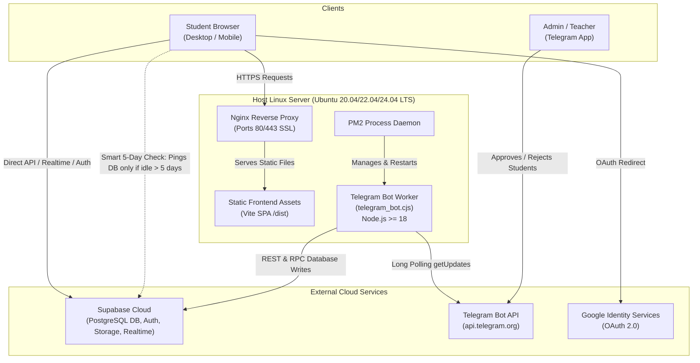

# Server Deployment & Operations Guide

This document defines the deployment architecture, server requirements, configuration variables (**what needs to change**), and architectural invariants (**what cannot be changed**) for the **College Presence & Verification Platform**.

---

## 1. System Architecture

The platform consists of three core components running across a host server and managed cloud infrastructure:



---

## 2. Server Requirements & Prerequisites

### 2.1 Hardware Requirements
| Resource | Minimum | Recommended | Notes |
| :--- | :--- | :--- | :--- |
| **CPU** | 1 vCPU | 2 vCPU | Single core is sufficient for production serving; 2 cores recommended for faster `npm run build`. |
| **RAM** | 1 GB | 2 GB | If on a 1 GB server, enable a 1 GB swap file to prevent out-of-memory (OOM) during frontend builds. |
| **Disk** | 10 GB SSD | 20 GB SSD | Accommodates Node.js runtime, build artifacts, and system logs. |

### 2.2 Software Stack
| Software | Required Version | Purpose |
| :--- | :--- | :--- |
| **Linux OS** | Ubuntu 20.04 / 22.04 / 24.04 LTS or Debian 11/12 | Host Operating System |
| **Node.js** | **>= 18.0.0** (v20.x LTS or v22.x LTS recommended) | Runtime for building frontend and running `telegram_bot.cjs` (requires native `fetch`) |
| **npm** | >= 9.x | Node package manager |
| **PM2** | Latest (`npm install -g pm2`) | Daemon process manager for continuous background execution of `telegram_bot.cjs` |
| **Nginx** | Latest stable (`apt install nginx`) | High-performance HTTP/HTTPS web server & SPA fallback routing |
| **Certbot** | Latest (`apt install certbot python3-certbot-nginx`) | Automated Let's Encrypt SSL/TLS certificates |

### 2.3 Network & Firewall Configuration
- **Inbound Ports**:
  - `80/TCP`: HTTP (auto-redirected to HTTPS)
  - `443/TCP`: HTTPS (production web traffic)
  - `22/TCP`: SSH server administration
- **Outbound Ports**:
  - `443/TCP`: Outbound HTTPS allowed to:
    - `https://*.supabase.co` (Database API, Realtime WebSockets, Storage)
    - `https://api.telegram.org` (Telegram Bot polling & messaging)
    - `https://accounts.google.com` (Google OAuth verification)

---

## 3. Step-by-Step Server Setup & Deployment

### Step 1: Server Directory Hierarchy
Follow directory jailing so other apps on the server are not affected:
```bash
# Create application directory
mkdir -p /home/ubuntu/apps/college-website
cd /home/ubuntu/apps/college-website

# Clone repository
git clone <your-repo-url> .
```

### Step 2: Install Node.js (v20 LTS) & PM2
```bash
# Install Node.js 20.x LTS repository
curl -fsSL https://deb.nodesource.com/setup_20.x | sudo -E bash -
sudo apt-get install -y nodejs nginx certbot python3-certbot-nginx

# Verify Node version (MUST be >= 18)
node -v

# Install PM2 globally
sudo npm install -g pm2
```

### Step 3: Configure Production `.env`
Create your `.env` file on the server:
```bash
cp .env.example .env
nano .env
```
Fill in all production credentials (see Section 4 for detailed guidance).

### Step 4: Install Dependencies & Build Frontend
```bash
# Install clean dependencies
npm ci

# Compile frontend TypeScript + Vite SPA into production bundle (dist/)
npm run build
```
Verify that `dist/index.html` and `dist/assets/` were created.

### Step 5: Configure Nginx Web Server
Create an Nginx configuration file:
```bash
sudo nano /etc/nginx/sites-available/college-website
```
Paste the following block (replace `college.yourdomain.com` and `/home/ubuntu/apps/college-website/dist` with your actual domain and path):

```nginx
server {
    listen 80;
    server_name college.yourdomain.com;

    # Root directory pointing to compiled Vite build
    root /home/ubuntu/apps/college-website/dist;
    index index.html;

    # Gzip compression for Three.js assets and scripts
    gzip on;
    gzip_types text/plain text/css application/json application/javascript text/xml application/xml application/xml+rss text/javascript;

    # Invariant: SPA fallback routing (DO NOT REMOVE)
    location / {
        try_files $uri $uri/ /index.html;
    }

    # Cache static build chunks with immutable hashes
    location /assets/ {
        expires 1y;
        add_header Cache-Control "public, no-transform, immutable";
    }

    # Security headers
    add_header X-Frame-Options "SAMEORIGIN";
    add_header X-Content-Type-Options "nosniff";
    add_header Referrer-Policy "strict-origin-when-cross-origin";
}
```

Enable site and restart Nginx:
```bash
sudo ln -s /etc/nginx/sites-available/college-website /etc/nginx/sites-enabled/
sudo nginx -t
sudo systemctl reload nginx
```

Obtain a free SSL/TLS certificate:
```bash
sudo certbot --nginx -d college.yourdomain.com
```

### Step 6: Start the Telegram Bot Daemon with PM2
```bash
# Start bot worker process
pm2 start telegram_bot.cjs --name "college-telegram-bot"

# Ensure PM2 automatically restarts bot upon server reboot
pm2 save
pm2 startup
# (Run the generated sudo env command shown in the terminal)
```

Check bot logs:
```bash
pm2 logs college-telegram-bot
```

---

## 4. What Needs to Change (Production & Environment-Specific Settings)

When setting up a new server or deploying from development to production, the following items **MUST** or **CAN** be modified:

### 4.1 Environment Variables (`.env`)
| Variable | Description | Change Required? | Example Production Value |
| :--- | :--- | :--- | :--- |
| `VITE_SUPABASE_URL` | Your Supabase project URL | **YES** | `https://abcdefghijklmnop.supabase.co` |
| `VITE_SUPABASE_ANON_KEY` | Public anonymous project API key | **YES** | `eyJhbGciOiJIUzI1NiIsInR5cCI...` |
| `VITE_GOOGLE_CLIENT_ID` | Google OAuth 2.0 Client ID for your web app | **YES** | `123456789-xyz.apps.googleusercontent.com` |
| `VITE_TELEGRAM_BOT_TOKEN` | Bot API token generated by `@BotFather` | **YES** | `7890123456:AAFl12345...` |
| `VITE_TELEGRAM_BOT_USERNAME` | Telegram handle of your bot (without `@`) | **YES** | `DevClassMcaVerificationBot` |
| `VITE_TELEGRAM_ADMIN_CHAT_ID` | Numeric Chat ID of teacher/admin receiving biometric approval requests | **YES** | `987654321` |
| `VITE_CLASSROOM_CODE` | Identifier code for the classroom / department | **Can change** | `MCA-BATCH-2026` or `CS-SEC-A` |
| `VITE_DAILY_CUTOFF_HOUR` | Daily attendance cutoff time (24h integer, e.g. 8 for 8:00 AM) | **Can change** | `8` (8 AM) or `9` (9 AM) |

### 4.2 Web Server & DNS Settings
- **Domain Name**: Update `server_name` in Nginx to match your domain (e.g., `attendance.collegename.edu`).
- **File System Paths**: Update `root` in Nginx configuration to point to where the project was cloned on your server (`/home/your-user/apps/college-website/dist`).
- **DNS Records**: Add an `A` record pointing `college.yourdomain.com` to your server's public IP address.

### 4.3 Google Cloud Console OAuth Configuration
1. Go to [Google Cloud Console Credentials](https://console.cloud.google.com/apis/credentials).
2. Under your OAuth 2.0 Client ID:
   - **Authorized JavaScript Origins**: Add your server domain (e.g., `https://college.yourdomain.com`).
   - **Authorized Redirect URIs**: MUST include `https://<your-supabase-project-id>.supabase.co/auth/v1/callback`.

### 4.4 Supabase Dashboard Configuration
1. Go to **Authentication -> URL Configuration**:
   - **Site URL**: `https://college.yourdomain.com`
   - **Redirect URLs**: Add `https://college.yourdomain.com/**`
2. Go to **Authentication -> Providers -> Google**:
   - Enable Google provider and paste your Google Client ID and Secret.
3. Run the SQL schema:
   - Copy contents of `supabase_schema.sql` into **SQL Editor** and execute it to generate all tables, RLS policies, and RPC functions.

---

## 5. What CANNOT Be Changed (Architectural Invariants)

Changing any of the following items will break application functionality:

### 5.1 Vite Environment Injection Timing
> [!IMPORTANT]
> **Vite injects `VITE_*` environment variables at BUILD TIME (`npm run build`), NOT at runtime.**
> - Updating `.env` on the server will have **zero effect on the frontend** until you re-run:
>   ```bash
>   npm run build
>   ```
> - The compiled JavaScript in `dist/` contains hardcoded values embedded during compilation.
> - Conversely, `telegram_bot.cjs` reads `.env` dynamically at runtime whenever it boots.

### 5.2 Environment Variable Prefixing
- All variables consumed by the React application **MUST** start with the prefix `VITE_` (e.g., `VITE_SUPABASE_URL`).
- If you rename `VITE_SUPABASE_URL` to `SUPABASE_URL`, Vite's bundler will strip it for security, and `import.meta.env.SUPABASE_URL` will be `undefined` in the browser, crashing all database and auth operations.

### 5.3 Nginx SPA Fallback Routing
- The following Nginx directive is strictly mandatory:
  ```nginx
  location / {
      try_files $uri $uri/ /index.html;
  }
  ```
- Because this is a Single Page Application (SPA), the browser manages routes. If Nginx does not fallback to `/index.html`, refreshing a page or navigating directly to a deep route returns a `404 Not Found`.

### 5.4 Database Schema Names & Constraints
Do NOT modify these names or constraints in `supabase_schema.sql` or PostgreSQL:
- **Table Names**: `users`, `daily_polls`, `votes`, `phone_verifications`, `chat_messages`.
- **Seat Number Constraint**: Strictly `seat_number BETWEEN 1 AND 46`. The 3D Three.js classroom scene is geometrically mapped to exactly 46 seat positions.
- **Biometric Approval Status**: Must remain `pending`, `verified`, or `rejected`. The UI and bot check these exact strings.
- **Storage Bucket Name**: Strictly `'face-scans'`. The biometric camera component uploads audit scans directly to this bucket name.
- **RPC Procedure Signature**: `public.set_student_approval(p_username TEXT, p_status TEXT, p_phone TEXT)`. The Telegram bot worker invokes this exact RPC function name when an admin taps "Approve" or "Reject".

### 5.5 Telegram Bot Long-Polling vs. Webhook Conflict
- `telegram_bot.cjs` uses **Telegram Long-Polling (`getUpdates`)**.
- **Rule 1**: You **cannot set a Telegram Webhook** on this bot token. If a webhook is active, Telegram rejects long-polling. The bot script automatically deletes webhooks upon boot, but keeping external webhooks configured will cause conflicts.
- **Rule 2**: **Never run multiple instances** of `telegram_bot.cjs` simultaneously with the same `VITE_TELEGRAM_BOT_TOKEN`. Running two copies (e.g. one in dev and one on the server) triggers `409 Conflict: terminated by other getUpdates request`, causing both instances to drop messages.

### 5.6 Node.js Runtime Requirement
- Node.js must be version **18.0.0 or higher**.
- `telegram_bot.cjs` utilizes native `fetch` and modern ESM/CJS interop. Running on Node 16 or lower will cause a fatal error: `ReferenceError: fetch is not defined`.

---

## 6. Supabase 7-Day Inactivity & Suspension Prevention

### 6.1 Why Supabase Pauses Projects
On the Supabase Free Tier, projects are **automatically paused after 7 consecutive days of inactivity** (no API requests, SQL queries, or dashboard visits). When paused:
- Supabase de-provisions the PostgreSQL container.
- DNS resolution for `<project-id>.supabase.co` is disabled (`ENOTFOUND`).
- Visitors and students receive connection failure errors.

### 6.2 Zero-Resource Visitor-Driven Keep-Alive (Smart 5-Day Threshold)
Instead of running separate background daemons, scheduled cron jobs, or CI/CD runners that consume memory and server resources, the application uses an **in-browser visitor-driven keep-alive check**:

1. **Client-Side Trigger on Visit**:
   - Whenever any user opens the website, `App.tsx` calls `supabaseService.checkAndTouchDatabaseIfStale()`.
2. **Pre-Execution 5-Day Staleness Check**:
   - Before firing any network request, it inspects `localStorage.getItem('college_db_last_accessed_at')`.
   - **If the database was accessed < 5 days ago**: The request is **immediately skipped** (0 network requests, zero bandwidth, zero overhead).
   - **If the database has not been accessed for >= 5 days** (or first-time visit): It sends a single lightweight ping (`GET /rest/v1/daily_polls?select=id&limit=1`) to Supabase.
   - Upon receiving the response, it updates the timestamp, resetting Supabase's 7-day inactivity pause counter.
3. **Automatic Refresh on User Actions**:
   - Any regular student activity (voting, chat message, login, profile edit) automatically refreshes the timestamp, ensuring no redundant keep-alive requests occur when the platform is actively used.

### 6.3 Emergency Recovery: If Your Database is Already Paused
If your project was already suspended before this deployment (`getaddrinfo ENOTFOUND <project-id>.supabase.co`):
1. Log in to [Supabase Dashboard](https://supabase.com/dashboard).
2. Click on your project.
3. Click the yellow/orange **"Restore project"** button.
4. The database and DNS will be restored within 1-2 minutes.
5. Once restored, the in-app 5-day check will prevent it from ever pausing again.

---

## 7. Daily Operations & Deployment Runbook

### How to Deploy Updates (CI/CD or Manual)
Whenever you push code changes to GitHub:
```bash
cd /home/ubuntu/apps/college-website

# 1. Pull latest code
git pull origin main

# 2. Re-install packages if package.json changed
npm ci

# 3. Re-compile frontend (updates build-time env & client bundle)
npm run build

# 4. Reload Telegram Bot worker (zero downtime)
pm2 restart college-telegram-bot

# 5. Check logs to confirm health
pm2 logs college-telegram-bot --lines 30
```

### Useful Maintenance Commands
```bash
# Check status of Telegram bot worker
pm2 status

# View live bot logs
pm2 logs college-telegram-bot

# Check Nginx status & logs
sudo systemctl status nginx
sudo tail -f /var/log/nginx/error.log
```

